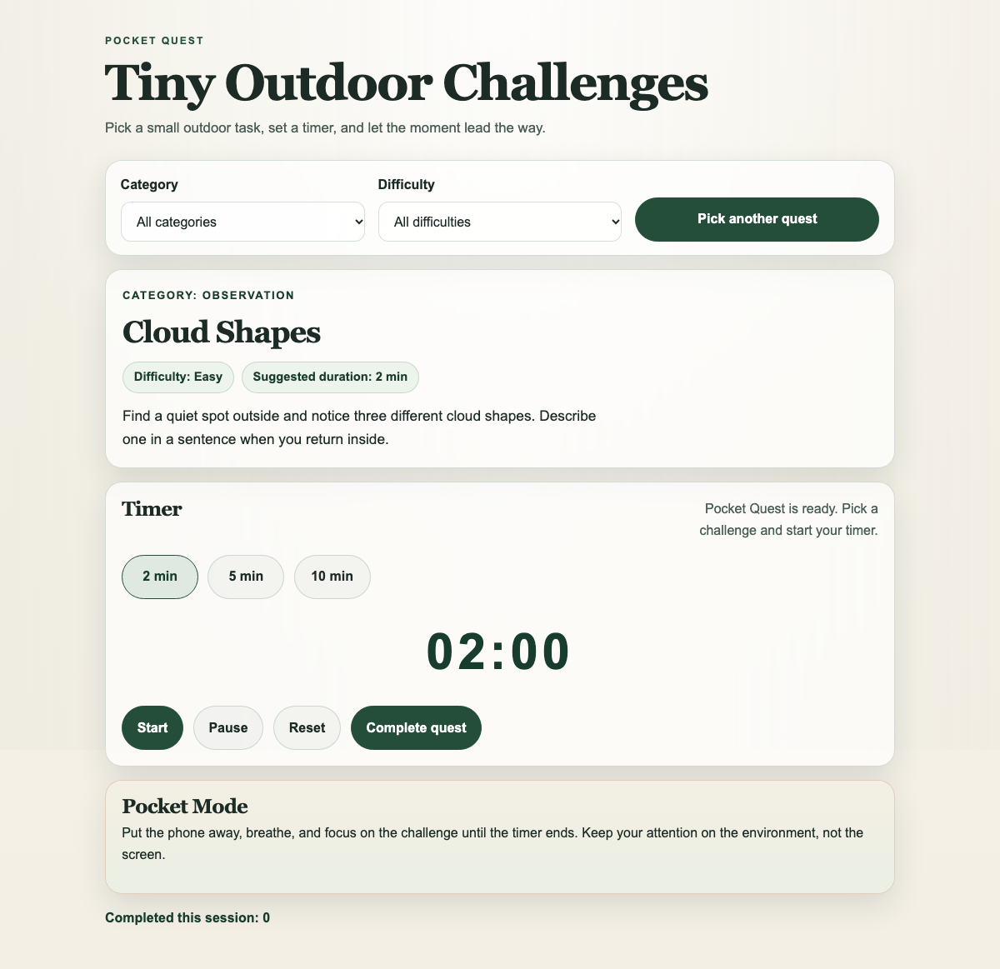
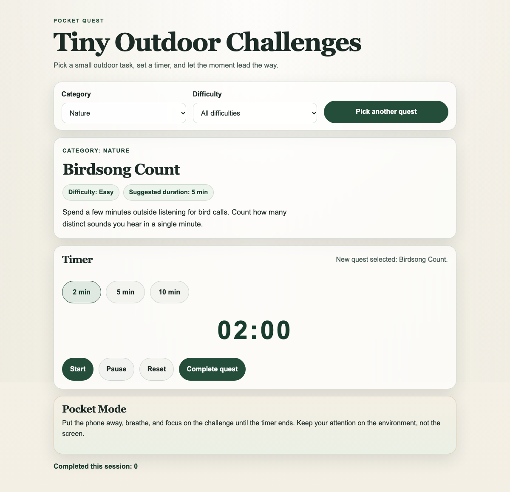
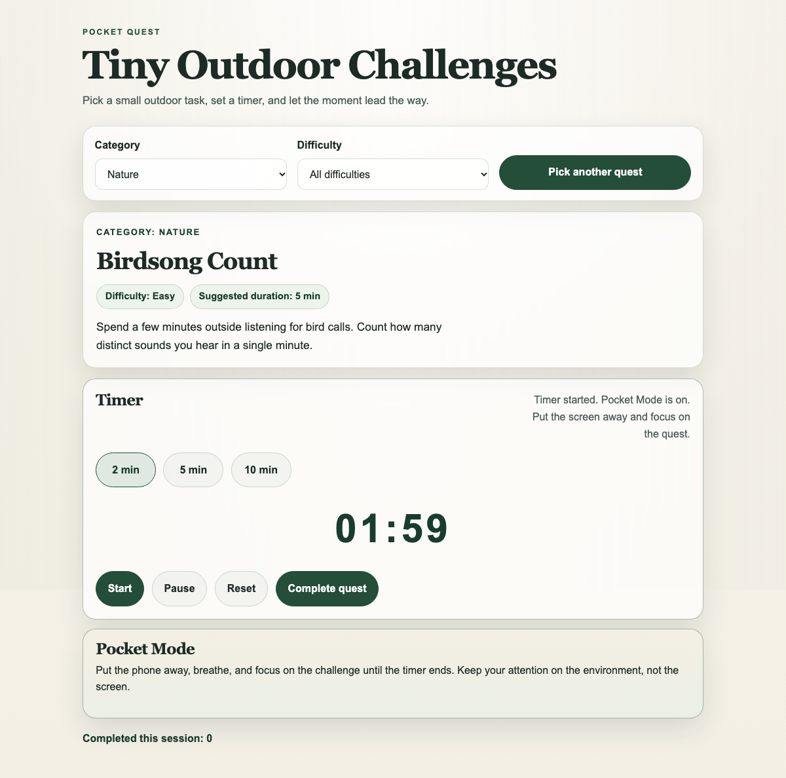
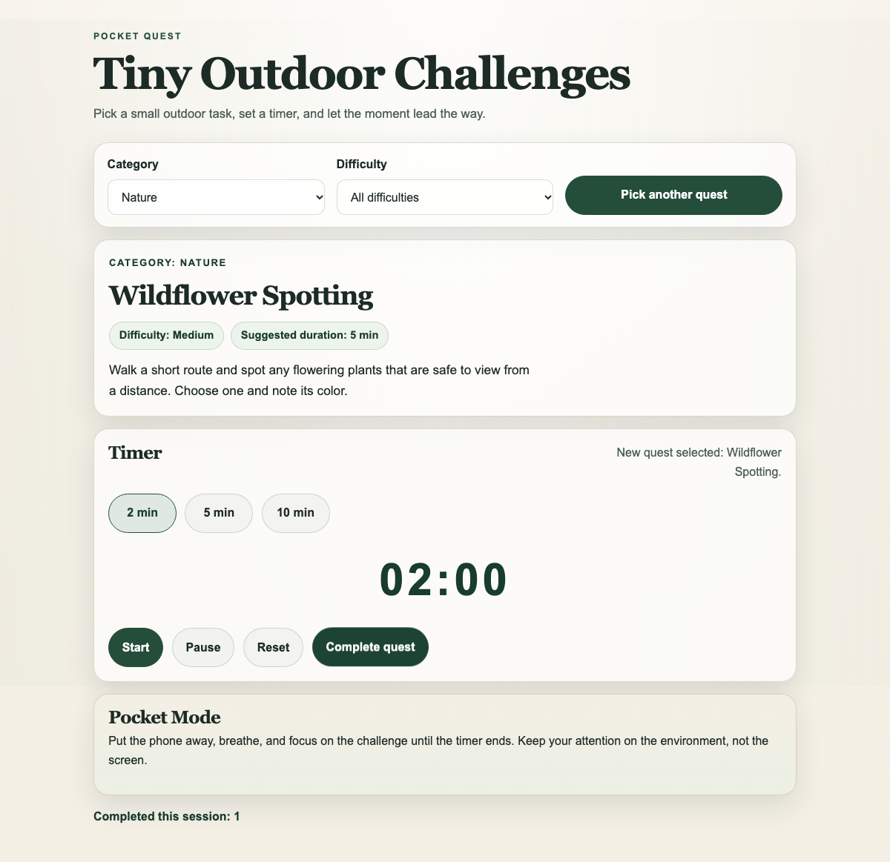
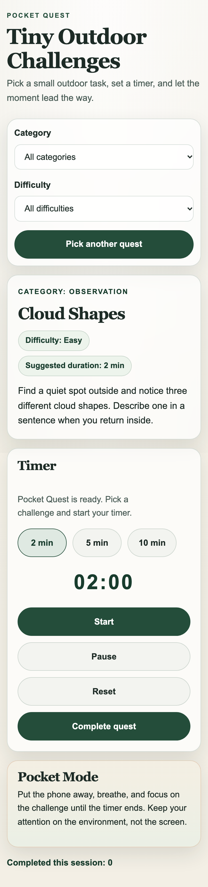

# Pocket Quest — Tiny Outdoor Challenges

**One small quest. A bigger world.**

Pocket Quest is a lightweight web application for small outdoor challenges that encourage movement, observation, creativity, and a healthy break from screens. It is designed for everyday outdoor spaces and works as a static site without an account, backend, or external services.

- 🚀 **Live Demo:** [https://suvendukungfu.github.io/pocket-quest/](https://suvendukungfu.github.io/pocket-quest/)
- 🤖 **GitHub Copilot Log:** [docs/COPILOT-LOG.md](docs/COPILOT-LOG.md)
- 📋 **MLH Challenge Audit:** [docs/MLH_COPILOT_CHALLENGE_AUDIT.md](docs/MLH_COPILOT_CHALLENGE_AUDIT.md)
- 🧪 **QA & Verification Report:** [docs/MLH_COPILOT_CHALLENGE_QA.md](docs/MLH_COPILOT_CHALLENGE_QA.md)
- 📝 **MLH Submission Draft:** [docs/MLH_COPILOT_CHALLENGE_SUBMISSION.md](docs/MLH_COPILOT_CHALLENGE_SUBMISSION.md)

---

## Screenshots

| Desktop Overview | Filtered Discovery |
| :---: | :---: |
|  |  |

| Active Timer & Pocket Mode | Quest Completed Flow | Mobile Viewport |
| :---: | :---: | :---: |
|  |  |  |

---

## Features

- **28 Short Quests:** Thoughtfully distributed across Observation, Nature, Movement, and Creativity.
- **Difficulty Tiers:** Filters for Easy, Medium, and Adventurous challenges.
- **Deterministic Repeat-Aware Selection:** Avoids recently viewed challenges while cycling predictably across categories without relying on unpredictable random functions.
- **Timer & Pocket Mode:** Optional 2-, 5-, and 10-minute timers with timestamp-delta drift prevention, start/pause/reset controls, and pocket-mode focus messaging.
- **Completion Flow:** Session counter tracking completed challenges during the current page visit.
- **Accessible & Responsive:** Semantic HTML, visible labels, keyboard focus styling, ARIA live region announcements, and reduced-motion media query support.
- **Zero Runtime Dependencies:** Pure HTML5, CSS3, and vanilla ES modules. Deployed automatically to GitHub Pages.

---

## Technology

- **Markup & Layout:** Semantic HTML5
- **Styling:** CSS3 custom properties with responsive mobile grid & glassmorphism
- **Logic:** Vanilla JavaScript using standard ES modules (zero external libraries)
- **Automated Testing:** Node.js built-in test runner (`node --test`)
- **CI/CD:** GitHub Actions for automated pull request checks and GitHub Pages deployment

---

## Local Setup & Run

Requirements: Node.js (v20+) with npm to run automated checks, and Python 3 to serve locally. The project has zero runtime dependencies to install.

From the project root, start a local static server:

```bash
python3 -m http.server 8000
```

Then open `http://localhost:8000` in your browser.

---

## Testing & Quality Assurance

Run the automated test suite and JavaScript syntax checks:

```bash
npm test
npm run check
```

**Test Suite Coverage:**
- 11 unit tests covering catalog integrity, case-insensitive filtering, balanced category/difficulty distribution, repeat-avoidance selection, and duration formatting.
- `node --check` syntax validation across all ES module source files.

---

## File Structure

```text
pocket-quest/
├── .github/
│   └── workflows/
│       └── deploy-pages.yml         # GitHub Actions CI/CD workflow
├── docs/
│   ├── screenshots/                 # Real application UI screenshots
│   │   ├── 01_main_desktop.png
│   │   ├── 02_filtered_discovery.png
│   │   ├── 03_timer_pocket_mode.png
│   │   ├── 04_quest_completed.png
│   │   └── 05_mobile_viewport.png
│   ├── COPILOT-LOG.md               # GitHub Copilot prompt history and learnings
│   ├── MLH_COPILOT_CHALLENGE_AUDIT.md # Technical challenge requirements audit
│   ├── MLH_COPILOT_CHALLENGE_QA.md  # Comprehensive test & browser verification report
│   └── MLH_COPILOT_CHALLENGE_SUBMISSION.md # MLH submission form answers & discussion post
├── src/
│   ├── app.js                       # UI controller, timer lifecycle, accessibility
│   └── quests.js                    # Pure data catalog and deterministic selection logic
├── tests/
│   └── quests.test.js               # Node.js native test suite
├── index.html                       # Semantic web page shell
├── styles.css                       # Responsive design system
├── package.json                     # Test scripts
├── README.md                        # Project documentation
├── CONTRIBUTING.md                  # Open-source contribution guide
├── LICENSE                          # MIT License
└── .gitignore                       # Clean Git configuration
```

---

## GitHub Pages Deployment

This repository includes a [GitHub Pages deployment workflow](.github/workflows/deploy-pages.yml). It runs on pushes to `main` and pull requests, and can be triggered manually from the Actions tab.

- **Verified Live Deployment:** [https://suvendukungfu.github.io/pocket-quest/](https://suvendukungfu.github.io/pocket-quest/)

---

## Accessibility, Privacy, and Safety

- **Accessibility:** Uses semantic HTML, visible labels, keyboard focus styling, ARIA live region status announcements, and respects `prefers-reduced-motion`.
- **Privacy:** No backend, no accounts, no tracking cookies, and no location/camera/analytics permissions requested.
- **Outdoor Safety:** Choose only safe and permitted locations. Skip or adapt any quest that does not suit your surroundings, abilities, or local conditions; never trespass or disturb wildlife.

---

## Known Limitations

- **Frontend-Only Scope:** Completion tracking lasts for the current browser session. A future update can add optional `localStorage` persistence.
- **Audio Cues:** Visual countdown and live region announcements are active; audible chimes or vibration cues are planned as future enhancements.

---

## License

This project is licensed under the MIT License. See [LICENSE](LICENSE) for details.
